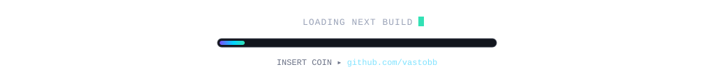

### `~$ whoami`

Android systems tinkerer on Fedora. I build software that makes a phone behave like a server: isolated app vaults, off-screen virtual displays, native mod loaders, and a renderer that has to survive a GLES driver. Everything here builds in CI on purpose — most of it gets written from a tethered terminal.

### `~$ ls ~/projects`

**`kuro`** — premium Android vault. Import an APK, run it isolated. Material 3 Compose UI, AMOLED dark-first, real logging and screenshot tests — and zero local Gradle, ever.
 `Kotlin · Compose · GitHub Actions`

  
  

**`ShadowAuto-Build` → Phantom** — virtual-display automation for AI agents. Real apps run off-screen, driven by tool calls over RPC, with H.264 preview, Paddle-Lite OCR fallback, and a Shizuku-hosted daemon. Ships `phantom-mcp`, so OpenCode can drive a phone like a browser tab.
 `Java · C++ · Python · Svelte · Shizuku`

**`fedora`** — reverse-engineering the LeviLaunchroid native mod loader. Ghidra runs in CI, signatures become candidates, and a validation gate refuses to let any hook ship without runtime evidence.
 `C++ · CMake · Python · Ghidra`

**`onigiri`** — screen-space renderer for Minecraft on Android. Sun-marched shadows, SSR and AO on a rotating sparse pass with temporal reprojection. Every shader is compile-checked in CI as GLSL ES 3.00 before it can reach a phone.
 `Java 25 · GLSL · Fabric · MobileGlues`

  
  

### `~$ htop --user=vastobb`

  
  
  
  
  
  

  
  
  
  
  
  

### `~$ git log --graph --all`

  
  

  <picture>
    <source media="(prefers-color-scheme: dark)" srcset="https://raw.githubusercontent.com/vastobb/vastobb/output/pacman-contribution-graph-dark.svg">
    
  </picture>

  <picture>
    <source media="(prefers-color-scheme: dark)" srcset="https://raw.githubusercontent.com/vastobb/vastobb/output/galaga-contribution-graph-dark.svg">
    
  </picture>

