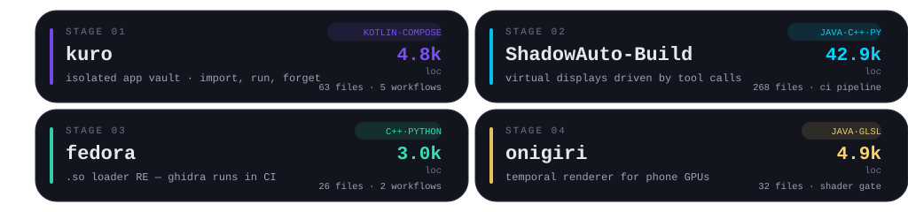

### `~$ whoami`

Android systems tinkerer on Fedora. I build software that makes a phone behave like a server: isolated app vaults, off-screen virtual displays, native mod loaders, and a renderer that has to survive a GLES driver. Everything here builds in CI on purpose — most of it gets written from a tethered terminal.

### `~$ ls ~/projects`

hover the cards — they light up

  <a href="https://github.com/vastobb/kuro"><b>kuro</b></a> ·
  <a href="https://github.com/vastobb/ShadowAuto-Build"><b>ShadowAuto-Build</b></a> ·
  <a href="https://github.com/vastobb/fedora"><b>fedora</b></a> ·
  <a href="https://github.com/vastobb/onigiri"><b>onigiri</b></a>

### `~$ htop --user=vastobb`

  
  
  
  
  
  

  
  
  
  
  
  

### `~$ git log --graph --all`

  
  

  <picture>
    <source media="(prefers-color-scheme: dark)" srcset="https://raw.githubusercontent.com/vastobb/vastobb/output/pacman-contribution-graph-dark.svg">
    
  </picture>

  <picture>
    <source media="(prefers-color-scheme: dark)" srcset="https://raw.githubusercontent.com/vastobb/vastobb/output/galaga-contribution-graph-dark.svg">
    
  </picture>

<b>🕹️ CHEAT CODES</b> — the konami stash &amp; credits

 

| input | effect |
|---|---|
| `↑ ↑ ↓ ↓ ← → ← → B A` | respect, but nothing happens… or does it |
| hover the chips up top | they wake up |
| hover the cards | they reveal where to go |
| hover `127.0.0.1:43110` | it tells the truth |
| view-source this file | there is one more message |

**How this page runs:** hand-computed SVG geometry (`tools/gen_assets.py` in this repo — zero generators, adjust the palette and re-run), [pacman-contribution-graph](https://github.com/abozanona/pacman-contribution-graph) for the arcade games, [github-profile-3d-contrib](https://github.com/yoshi389111/github-profile-3d-contrib) for the isometric year, [github-readme-stats](https://github.com/anuraghazra/github-readme-stats) and [shields.io](https://shields.io) for the readouts. Everything else is SMIL keyframes and stubbornness.

**Achievements unlocked:**

- `◆ WALL BREAKER` — 55k+ lines of android internals, read end to end, no skimming
- `◆ SIDE QUEST` — every animation here is SMIL; no scripts survive GitHub's sanitizer anyway
- `◆ NO SLOP` — if it moves, there is a keyframe for it somewhere in this repo

<!-- ↑↑↓↓←→←→BA -->
