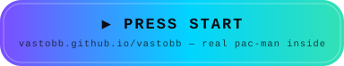
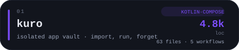
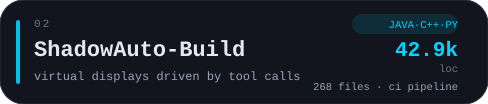
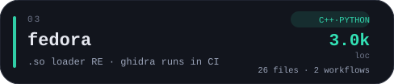
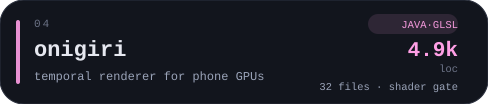
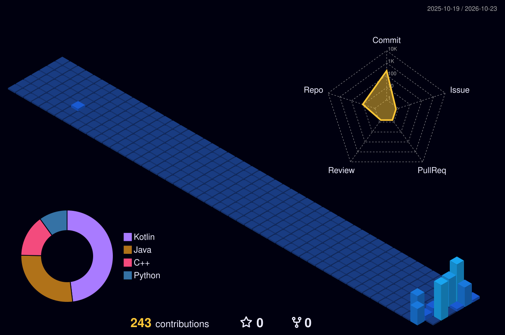

### `~$ whoami`

Android systems tinkerer on Fedora. I build software that makes a phone behave like a server: isolated app vaults, off-screen virtual displays, native mod loaders, and a renderer that has to survive a GLES driver. Everything above is fake — the button is real. It boots a CRT, then it hands you a Pac-Man with hunting ghosts.

### `~$ ls ~/projects`

  
  

  
  

### `~$ htop --user=vastobb`

  
  
  
  
  
  

  
  
  
  
  
  

### `~$ git log --graph --all`

  
  

  <picture>
    <source media="(prefers-color-scheme: dark)" srcset="https://raw.githubusercontent.com/vastobb/vastobb/output/pacman-contribution-graph-dark.svg">
    
  </picture>

  <picture>
    <source media="(prefers-color-scheme: dark)" srcset="https://raw.githubusercontent.com/vastobb/vastobb/output/galaga-contribution-graph-dark.svg">
    
  </picture>

<b>🕹️ CHEAT CODES</b> — what actually happens when you press things

 

| input | result |
|---|---|
| **▶ PRESS START** (top of page) | boots a real CRT arcade — Pac-Man with 4 hunting ghosts, Breakout, square-wave chiptunes, zero assets |
| `↑ ↑ ↓ ↓ ← → ← → B A` | **does something here.** rainbow mode. the ghosts change color. respect |
| score past `1337` in the arcade | `◆ WALL BREAKER` — it calls you out |
| hover the chips in the hero | they wake up |
| hover a project card | it lifts and shows you where to go |
| hover `127.0.0.1:43110` | it tells the truth |
| view-source this file | one more message |

**How this page runs:** the hero, cabinet and cards are hand-computed SVG geometry (`tools/gen_assets.py` — one python file, no design tools, no generated images). The arcade is `web/index.html` — a single 40KB HTML file: canvas 2D, a BFS pathfinder for the ghosts, WebAudio square waves for the sound. No engines, no sprite sheets, no dependencies. The rest: [pacman-contribution-graph](https://github.com/abozanona/pacman-contribution-graph) for the daily arcade graphs, [github-profile-3d-contrib](https://github.com/yoshi389111/github-profile-3d-contrib) for the isometric year, [github-readme-stats](https://github.com/anuraghazra/github-readme-stats) + [shields.io](https://shields.io) for the readouts.

**Achievements:** `◆ WALL BREAKER` (beat 1337) · `◆ SIDE QUEST` (you read this far) · `◆ NO SLOP` (every animation is a keyframe someone typed)

  

<!-- ↑↑↓↓←→←→BA -->
